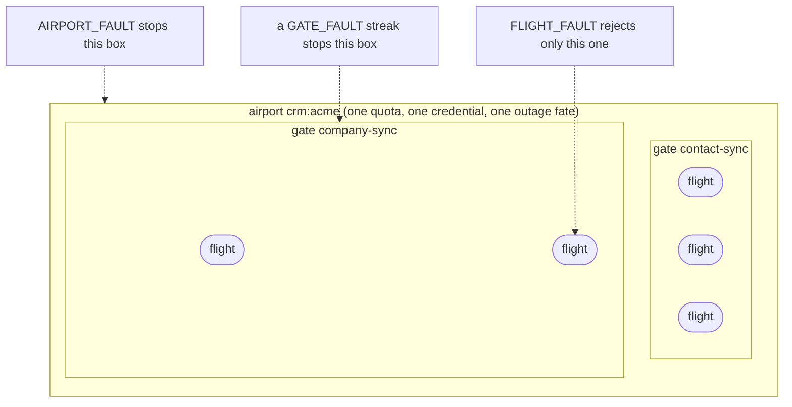

# Concepts & glossary

*Three nested scopes, each one stoppable on its own. Everything else is the machinery around
them.*

The aviation words are a memory hook, not an entry fee: every term below has a plain-words
alias, and the code uses the same words as the docs.

## The containment picture

*An airport holds gates; a gate holds flights. A stop at one level never touches its siblings.*



Stopping `company-sync` leaves `contact-sync` landing. Stopping the airport stops both, and
rejecting one flight stops nothing.

## Glossary

*Metaphor on the left, plain words in the middle, where it lives on the right.*

| Term | Plain words | In the code |
|---|---|---|
| **Airport** | One governed dependency: one shared quota, credential set and outage fate | `AirportSpec.of("crm:acme")` |
| **Gate** | One independently stoppable work type on that dependency | `.gate("contact-sync")`, or `.gate(id, slotCost)` |
| **Flight** | One message: one unit of work | `Flight<T>` |
| **Pilot** | Your code that does the work for one flight | `Pilot<T>.land(flight)` |
| **Reporter** | Your code that says what an outcome means | `FlightReporter.report(flight, error)` |
| **Tower** | Where you send work; also the control plane's event queue | `Tower.dispatch(airportId, gateId, payload)`, `tr.tower.queue` |
| **Slots / clearance** | The shared rate limit, checked before every flight | `.slots(20, Duration.ofSeconds(1))` |
| **Runway** | The work queue of an airport | `tr.crm:acme.runway` |
| **Holding** | The retry-with-backoff queue | `tr.crm:acme.holding` |
| **Parked** | Where flights wait for a human: recoverable, never failed | `tr.crm:acme.parked` |
| **Ground stop** | Stop consuming an airport or one gate until reopened | status `GROUND_STOP` |
| **Ground delay** | A short, self-expiring pause after the vendor throttles you | `RATE_LIMIT` |
| **Reopen** | Resume a stopped airport or gate (always explicit) | admin API |
| **Replay / discard** | Send parked flights back to the runway / drop them for good | admin API |
| **Charter** | A bulk run, tracked to completion | `CharterDesk.open(...)` |
| **Skip window** | After an abort, the run's remaining flights are counted skipped and dropped, not kept (7 days) | `CHARTER_ABORTED` |
| **Category** | The level a failure breaks | `IncidentCategory` |
| **Evidence** | What went wrong, bounded and PII-free (you strip PII) | `Evidence.from(t)` |
| **Streak** | N distinct records failing the same way in a window | 3 `GATE_FAULT`s, or 5 `FLIGHT_FAULT`/`INTERNAL`, in 5 min |
| **Data plane** | Every service that consumes flights | `traction-core` in each service |
| **Control plane** | The one service that decides: rules, status, charters, admin API | `traction.control-plane.enabled=true` |

### Outcomes and dispositions

*Every flight ends in one of three outcomes; its disposition says whether it's finished.*

- **Outcome:** `LANDED`, `SKIPPED`, or `INCIDENT`.
- **Disposition:** `RETRYING` (still in progress), `PARKED` (waiting for a human), or `TERMINAL`
  (finished, nothing more will happen).
- **Row type:** `RECORD` is a settled outcome; `INTERIM` is a step on the way (`HELD_1`,
  `DEFERRED`) and is never counted. See [guarantees](guarantees.md).

## The id scheme

*Ids are plain strings that become queue names and Redis keys, so they're restricted.*

| Id | Shape | Example |
|---|---|---|
| `airportId` | `[a-zA-Z0-9:_\-.]+`, by convention `<kind>:<vendor>` | `crm:acme`, `mail:acme` |
| `gateId` | same characters | `contact-sync` |
| `charterId` | `[a-zA-Z0-9_\-.]+` (no `:` or `/`), unique per gate | `run-1792774953` |
| `charterRef` | `airportId/gateId/charterId` | `mail:acme/welcome/run-1792774953` |
| `flightId` | a UUID minted per dispatch | |
| `domainRef` | your business id; the idempotency and streak key | `contact-42` |
| `correlationId` | 6 characters, on every log line of the flight (MDC `correlationId`) | `3af5f7` |

Queues are `tr.<airportId>.runway|holding|parked`, plus one `tr.tower.queue` and its `tr.dlq`.
Redis keys start with `tr:` (for example `tr:status:crm:acme`, `tr:slots:crm:acme`). Set the
`domainRef` when you dispatch:

```java
tower.dispatch("crm:acme", "contact-sync", contact, new DispatchOptions(contact.id(), null));
```

One airport has one owning service: don't split one airport's consumers across services. Next:
[the life of a flight](life-of-a-flight.md).
