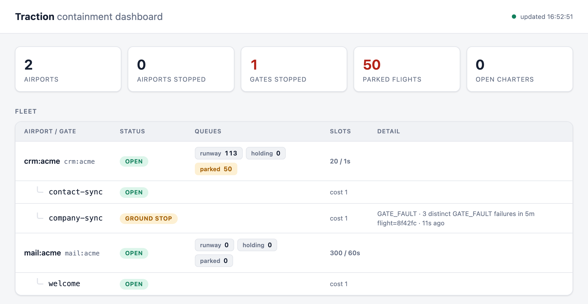

# The retry storm that ate 40,000 messages

<p class="byline"><span>Dhananjay · Traction · <time datetime="2026-10-24">24 Oct 2026</time> · 13 min read</span></p>

## 2 a.m.

An API token expired overnight. That was the whole root cause: one credential, for one
third-party API, reached the end of its life while nobody was looking.

The consumer that depended on it was not careless code. It was built the way the tutorials
and the postmortems say to build one. It caught exceptions and logged them with a stack trace.
It retried, with a limit, so no message could go around forever. Past the limit, the broker
dead-lettered the message instead of dropping it. By every checklist I knew, it was a
well-built consumer.

It did exactly what it was built to do. Every message called the API, was refused, logged an
error, went back on the queue, and tried again. Each message found out about the expired token
on its own. Each one used up its retries on its own. Then each one went to the dead-letter
queue, on its own.

By morning the dead-letter queue held 40,000 messages, and every one of them was customer data
that should have reached the vendor and hadn't. Technically nothing was lost. But nothing had
been done either, and the recovery was manual: fix the token, move the messages back by hand,
and hope nothing else had landed in that queue for a different reason.

What stayed with me afterwards wasn't the token. Tokens expire. It was that the system had the
information it needed to stop after the first failure, and no part of it was in a position to
use it. Every message failed for the same reason, and every message was treated as if its
failure were its own.

The usual fix is a hand-rolled circuit breaker for that one consumer. Then the next consumer
needs one, and each is slightly different from the last. This article
is about the version I'd want instead, and the reference implementation I built for it:
[Traction](https://github.com/dhananjaym-dev/traction), open source, running on a laptop with
Docker. Every measured number below comes from its included demo, not from that night.

## The failure has three sizes

A queue consumer calling a third party sees one thing when a call fails: an exception. But
that exception can mean three very different things, and the right response to each is
different.

- **One bad record.** A contact with an invalid email address. Retrying it will never work,
  and it says nothing about the next message. The right move is to reject it and keep going.
- **One broken endpoint.** The vendor changed the contract for company records. Every company
  sync fails, while contact syncs against the same vendor are fine. The right move is to stop
  company syncs, keep the work, and let contacts carry on.
- **The whole connection.** The token expired. Every call of every kind fails, and will keep
  failing until a human does something. The right move is to stop everything on the first
  failure and keep every message until that human is done.

<figure class="diagram diagram-sizes">
<div class="d-sizes">
<div class="d-size">
<p class="d-kicker">One flight</p>
<p class="d-what">One contact has an invalid email</p>
<svg viewBox="0 0 260 128" xmlns="http://www.w3.org/2000/svg" role="img" aria-label="Inside acme CRM, one flight in contact-sync has failed. Every other contact-sync flight and every company-sync flight is fine." style="width:100%;height:auto"><g style="font-family:var(--d-sans, Barlow, 'Helvetica Neue', Arial, sans-serif)"><rect x="1" y="1" width="258" height="126" rx="6" fill="var(--d-box, #FAFAF8)" stroke="var(--d-ink, #16181B)" stroke-width="1.5"/><text x="12" y="19" font-size="13" fill="var(--d-ink, #16181B)" font-weight="600">acme CRM</text><rect x="10" y="28" width="115" height="90" rx="4" fill="var(--d-cell, #FFFFFF)" stroke="var(--d-frame, #8E9398)" stroke-width="1.2"/><text x="19" y="46" font-size="12" fill="var(--d-ink, #16181B)" font-weight="600" style="font-family:var(--d-mono, 'IBM Plex Mono', ui-monospace, Menlo, monospace)">contact-sync</text><rect x="19" y="58" width="29" height="18" rx="2" fill="var(--d-cell, #FFFFFF)" stroke="var(--d-cell-line, #9AA0A5)" stroke-width="1.2"/><rect x="53" y="58" width="29" height="18" rx="2" fill="var(--d-cell, #FFFFFF)" stroke="var(--d-cell-line, #9AA0A5)" stroke-width="1.2"/><rect x="87" y="58" width="29" height="18" rx="2" fill="var(--d-cell, #FFFFFF)" stroke="var(--d-cell-line, #9AA0A5)" stroke-width="1.2"/><rect x="19" y="86" width="29" height="18" rx="2" fill="var(--d-cell, #FFFFFF)" stroke="var(--d-cell-line, #9AA0A5)" stroke-width="1.2"/><rect x="53" y="86" width="29" height="18" rx="2" fill="var(--d-red, #C4302B)"/><rect x="87" y="86" width="29" height="18" rx="2" fill="var(--d-cell, #FFFFFF)" stroke="var(--d-cell-line, #9AA0A5)" stroke-width="1.2"/><rect x="135" y="28" width="115" height="90" rx="4" fill="var(--d-cell, #FFFFFF)" stroke="var(--d-frame, #8E9398)" stroke-width="1.2"/><text x="144" y="46" font-size="12" fill="var(--d-ink, #16181B)" font-weight="600" style="font-family:var(--d-mono, 'IBM Plex Mono', ui-monospace, Menlo, monospace)">company-sync</text><rect x="144" y="58" width="29" height="18" rx="2" fill="var(--d-cell, #FFFFFF)" stroke="var(--d-cell-line, #9AA0A5)" stroke-width="1.2"/><rect x="178" y="58" width="29" height="18" rx="2" fill="var(--d-cell, #FFFFFF)" stroke="var(--d-cell-line, #9AA0A5)" stroke-width="1.2"/><rect x="212" y="58" width="29" height="18" rx="2" fill="var(--d-cell, #FFFFFF)" stroke="var(--d-cell-line, #9AA0A5)" stroke-width="1.2"/><rect x="144" y="86" width="29" height="18" rx="2" fill="var(--d-cell, #FFFFFF)" stroke="var(--d-cell-line, #9AA0A5)" stroke-width="1.2"/><rect x="178" y="86" width="29" height="18" rx="2" fill="var(--d-cell, #FFFFFF)" stroke="var(--d-cell-line, #9AA0A5)" stroke-width="1.2"/><rect x="212" y="86" width="29" height="18" rx="2" fill="var(--d-cell, #FFFFFF)" stroke="var(--d-cell-line, #9AA0A5)" stroke-width="1.2"/></g></svg>
<dl><dt>Hits</dt><dd>that one contact</dd><dt>Right move</dt><dd class="d-move">record it, keep going</dd></dl>
</div>
<div class="d-size">
<p class="d-kicker">One gate</p>
<p class="d-what">The company endpoint changed its contract</p>
<svg viewBox="0 0 260 128" xmlns="http://www.w3.org/2000/svg" role="img" aria-label="Inside acme CRM, every company-sync flight has failed. Every contact-sync flight is fine." style="width:100%;height:auto"><g style="font-family:var(--d-sans, Barlow, 'Helvetica Neue', Arial, sans-serif)"><rect x="1" y="1" width="258" height="126" rx="6" fill="var(--d-box, #FAFAF8)" stroke="var(--d-ink, #16181B)" stroke-width="1.5"/><text x="12" y="19" font-size="13" fill="var(--d-ink, #16181B)" font-weight="600">acme CRM</text><rect x="10" y="28" width="115" height="90" rx="4" fill="var(--d-cell, #FFFFFF)" stroke="var(--d-frame, #8E9398)" stroke-width="1.2"/><text x="19" y="46" font-size="12" fill="var(--d-ink, #16181B)" font-weight="600" style="font-family:var(--d-mono, 'IBM Plex Mono', ui-monospace, Menlo, monospace)">contact-sync</text><rect x="19" y="58" width="29" height="18" rx="2" fill="var(--d-cell, #FFFFFF)" stroke="var(--d-cell-line, #9AA0A5)" stroke-width="1.2"/><rect x="53" y="58" width="29" height="18" rx="2" fill="var(--d-cell, #FFFFFF)" stroke="var(--d-cell-line, #9AA0A5)" stroke-width="1.2"/><rect x="87" y="58" width="29" height="18" rx="2" fill="var(--d-cell, #FFFFFF)" stroke="var(--d-cell-line, #9AA0A5)" stroke-width="1.2"/><rect x="19" y="86" width="29" height="18" rx="2" fill="var(--d-cell, #FFFFFF)" stroke="var(--d-cell-line, #9AA0A5)" stroke-width="1.2"/><rect x="53" y="86" width="29" height="18" rx="2" fill="var(--d-cell, #FFFFFF)" stroke="var(--d-cell-line, #9AA0A5)" stroke-width="1.2"/><rect x="87" y="86" width="29" height="18" rx="2" fill="var(--d-cell, #FFFFFF)" stroke="var(--d-cell-line, #9AA0A5)" stroke-width="1.2"/><rect x="135" y="28" width="115" height="90" rx="4" fill="var(--d-red-wash, #F7E1DE)" stroke="var(--d-red, #C4302B)" stroke-width="2"/><text x="144" y="46" font-size="12" fill="var(--d-red-text, #9E2520)" font-weight="600" style="font-family:var(--d-mono, 'IBM Plex Mono', ui-monospace, Menlo, monospace)">company-sync</text><rect x="144" y="58" width="29" height="18" rx="2" fill="var(--d-red, #C4302B)"/><rect x="178" y="58" width="29" height="18" rx="2" fill="var(--d-red, #C4302B)"/><rect x="212" y="58" width="29" height="18" rx="2" fill="var(--d-red, #C4302B)"/><rect x="144" y="86" width="29" height="18" rx="2" fill="var(--d-red, #C4302B)"/><rect x="178" y="86" width="29" height="18" rx="2" fill="var(--d-red, #C4302B)"/><rect x="212" y="86" width="29" height="18" rx="2" fill="var(--d-red, #C4302B)"/></g></svg>
<dl><dt>Hits</dt><dd>every company sync; contacts are fine</dd><dt>Right move</dt><dd class="d-move">stop that gate, keep its work</dd></dl>
</div>
<div class="d-size">
<p class="d-kicker">The whole airport</p>
<p class="d-what">The token expired</p>
<svg viewBox="0 0 260 128" xmlns="http://www.w3.org/2000/svg" role="img" aria-label="Everything inside acme CRM has failed: every contact-sync flight and every company-sync flight." style="width:100%;height:auto"><g style="font-family:var(--d-sans, Barlow, 'Helvetica Neue', Arial, sans-serif)"><rect x="1" y="1" width="258" height="126" rx="6" fill="var(--d-red-wash, #F7E1DE)" stroke="var(--d-red, #C4302B)" stroke-width="2"/><text x="12" y="19" font-size="13" fill="var(--d-red-text, #9E2520)" font-weight="600">acme CRM</text><rect x="10" y="28" width="115" height="90" rx="4" fill="var(--d-cell, #FFFFFF)" stroke="var(--d-red, #C4302B)" stroke-width="1.2"/><text x="19" y="46" font-size="12" fill="var(--d-red-text, #9E2520)" font-weight="600" style="font-family:var(--d-mono, 'IBM Plex Mono', ui-monospace, Menlo, monospace)">contact-sync</text><rect x="19" y="58" width="29" height="18" rx="2" fill="var(--d-red, #C4302B)"/><rect x="53" y="58" width="29" height="18" rx="2" fill="var(--d-red, #C4302B)"/><rect x="87" y="58" width="29" height="18" rx="2" fill="var(--d-red, #C4302B)"/><rect x="19" y="86" width="29" height="18" rx="2" fill="var(--d-red, #C4302B)"/><rect x="53" y="86" width="29" height="18" rx="2" fill="var(--d-red, #C4302B)"/><rect x="87" y="86" width="29" height="18" rx="2" fill="var(--d-red, #C4302B)"/><rect x="135" y="28" width="115" height="90" rx="4" fill="var(--d-cell, #FFFFFF)" stroke="var(--d-red, #C4302B)" stroke-width="1.2"/><text x="144" y="46" font-size="12" fill="var(--d-red-text, #9E2520)" font-weight="600" style="font-family:var(--d-mono, 'IBM Plex Mono', ui-monospace, Menlo, monospace)">company-sync</text><rect x="144" y="58" width="29" height="18" rx="2" fill="var(--d-red, #C4302B)"/><rect x="178" y="58" width="29" height="18" rx="2" fill="var(--d-red, #C4302B)"/><rect x="212" y="58" width="29" height="18" rx="2" fill="var(--d-red, #C4302B)"/><rect x="144" y="86" width="29" height="18" rx="2" fill="var(--d-red, #C4302B)"/><rect x="178" y="86" width="29" height="18" rx="2" fill="var(--d-red, #C4302B)"/><rect x="212" y="86" width="29" height="18" rx="2" fill="var(--d-red, #C4302B)"/></g></svg>
<dl><dt>Hits</dt><dd>every call to acme, of every kind</dd><dt>Right move</dt><dd class="d-move">ground-stop the airport, keep everything</dd></dl>
</div>
</div>
<figcaption>One dependency, three sizes of failure, three different right moves. A retry policy applies the same move to all three.</figcaption>
</figure>

A retry policy can't tell these apart. It sees one exception at a time, in one consumer
thread, on one pod. A retry count, a backoff schedule and a dead-letter queue are all
per-message tools, so they apply the per-message move to all three sizes: try again, then give
up. For the bad record that's harmless waste. For the broken endpoint it's an alert per
message. For the dead token it's the storm.

Some failures aren't a size at all. A timeout, a 5xx blip or the vendor throttling you says
"not right now", not "this is broken". Those deserve a pause or a backoff, and retries are the
right tool for them, which is part of why retries get used for everything else.

The important thing about the three sizes is where they come from. Whether a failure is
record-sized, endpoint-sized or connection-sized is a property of *how your work depends on
the vendor*, not of the exception's class name. An expired token is connection-sized for
every consumer that shares it. A changed endpoint is sized to the work that calls it. That
means the size can be declared once, up front, instead of rediscovered by every message.

Acting on it needs shared state. One consumer thread can't see that three *different*
company records failed the same way in five minutes, across every pod: that takes a shared
counter. Stopping every pod at once takes a shared status, and pacing every pod to one vendor
quota takes a shared rate limit. Then someone has to notify a human once, not once per
message, and give them a way to resume. That's a lot of plumbing to write per consumer. The
[problem page](the-problem.md) walks the three sizes through two complete examples.

## Think airports, not retries

I needed words for the three scopes that weren't "service", "queue" and "message", which all
mean something else already. I ended up with an airport.

An **airport** is one governed dependency: one shared quota, one credential set, one outage
fate. A **gate** is one independently stoppable work type on that dependency. A **flight** is
one message. In the demo, a CRM account is the airport, contact sync and company sync are its
gates, and each queued sync is a flight:

```text
airport  crm:acme        one quota, one credential, one outage fate
├── gate  contact-sync   one work type, stoppable on its own
│   └── flights          one message each
└── gate  company-sync
    └── flights
```

The containment rule follows from the nesting: a stop at one level never touches its
siblings. Stopping `company-sync` leaves `contact-sync` landing. Stopping the airport stops
both. Rejecting one flight stops nothing.

<figure class="diagram diagram-vocab">
<svg class="d-wide" viewBox="0 0 480 352" xmlns="http://www.w3.org/2000/svg" role="img" aria-label="The airport crm:acme, one CRM account, contains two gates, contact-sync and company-sync. Each gate holds its own flights, one message each, shown as landed, parked or skipped: contacts 1042 to 1046 in contact-sync, companies 88 to 92 in company-sync." style="width:100%;height:auto"><g style="font-family:var(--d-sans, Barlow, 'Helvetica Neue', Arial, sans-serif)"><rect x="1" y="1" width="478" height="350" rx="8" fill="var(--d-card, #FFFFFF)" stroke="var(--d-ink, #16181B)" stroke-width="2"/><rect x="14" y="14" width="84" height="26" rx="3" fill="var(--d-tower, #16181B)"/><text x="56" y="32" font-size="14" fill="var(--d-tower-accent, #F5C400)" font-weight="600" text-anchor="middle" letter-spacing="1.4" style="font-family:var(--d-cond, 'Barlow Condensed', 'Arial Narrow', sans-serif)">AIRPORT</text><text x="110" y="32" font-size="13" fill="var(--d-ink, #16181B)" style="font-family:var(--d-mono, 'IBM Plex Mono', ui-monospace, Menlo, monospace)">crm:acme<tspan fill="var(--d-muted, #50565C)" dx="10" style="font-family:var(--d-sans, Barlow, 'Helvetica Neue', Arial, sans-serif)">one CRM account</tspan></text><rect x="14" y="54" width="222" height="284" rx="6" fill="var(--d-panel, #F4F5F3)" stroke="var(--d-frame, #8E9398)" stroke-width="1.4"/><rect x="26" y="66" width="62" height="22" rx="3" fill="var(--d-cell, #FFFFFF)" stroke="var(--d-ink, #16181B)" stroke-width="1.5"/><text x="57" y="82" font-size="13" fill="var(--d-ink, #16181B)" font-weight="600" text-anchor="middle" letter-spacing="1.3" style="font-family:var(--d-cond, 'Barlow Condensed', 'Arial Narrow', sans-serif)">GATE</text><text x="26" y="116" font-size="16" fill="var(--d-ink, #16181B)" font-weight="600" style="font-family:var(--d-mono, 'IBM Plex Mono', ui-monospace, Menlo, monospace)">contact-sync</text><text x="26" y="134" font-size="12" fill="var(--d-muted, #50565C)">one work type, stoppable alone</text><text x="26" y="160" font-size="12" fill="var(--d-muted, #50565C)" font-weight="600" letter-spacing="1.2" style="font-family:var(--d-cond, 'Barlow Condensed', 'Arial Narrow', sans-serif)">FLIGHTS</text><rect x="26" y="170" width="198" height="26" rx="2" fill="var(--d-box, #FAFAF8)" stroke="var(--d-ink, #16181B)" stroke-width="1.2"/><rect x="146" y="170" width="78" height="26" fill="var(--d-green, #1B7A4C)"/><text x="36" y="187" font-size="12" fill="var(--d-ink, #16181B)" style="font-family:var(--d-mono, 'IBM Plex Mono', ui-monospace, Menlo, monospace)">contact 1042</text><text x="185" y="188" font-size="12.5" fill="var(--d-pill-text, #FFFFFF)" font-weight="600" text-anchor="middle" letter-spacing="0.8" style="font-family:var(--d-cond, 'Barlow Condensed', 'Arial Narrow', sans-serif)">LANDED</text><rect x="26" y="202" width="198" height="26" rx="2" fill="var(--d-box, #FAFAF8)" stroke="var(--d-ink, #16181B)" stroke-width="1.2"/><rect x="146" y="202" width="78" height="26" fill="var(--d-green, #1B7A4C)"/><text x="36" y="219" font-size="12" fill="var(--d-ink, #16181B)" style="font-family:var(--d-mono, 'IBM Plex Mono', ui-monospace, Menlo, monospace)">contact 1043</text><text x="185" y="220" font-size="12.5" fill="var(--d-pill-text, #FFFFFF)" font-weight="600" text-anchor="middle" letter-spacing="0.8" style="font-family:var(--d-cond, 'Barlow Condensed', 'Arial Narrow', sans-serif)">LANDED</text><rect x="26" y="234" width="198" height="26" rx="2" fill="var(--d-box, #FAFAF8)" stroke="var(--d-ink, #16181B)" stroke-width="1.2"/><rect x="146" y="234" width="78" height="26" fill="var(--d-blue, #2A5CAA)"/><text x="36" y="251" font-size="12" fill="var(--d-ink, #16181B)" style="font-family:var(--d-mono, 'IBM Plex Mono', ui-monospace, Menlo, monospace)">contact 1044</text><text x="185" y="252" font-size="12.5" fill="var(--d-pill-text, #FFFFFF)" font-weight="600" text-anchor="middle" letter-spacing="0.8" style="font-family:var(--d-cond, 'Barlow Condensed', 'Arial Narrow', sans-serif)">PARKED</text><rect x="26" y="266" width="198" height="26" rx="2" fill="var(--d-box, #FAFAF8)" stroke="var(--d-ink, #16181B)" stroke-width="1.2"/><rect x="146" y="266" width="78" height="26" fill="var(--d-green, #1B7A4C)"/><text x="36" y="283" font-size="12" fill="var(--d-ink, #16181B)" style="font-family:var(--d-mono, 'IBM Plex Mono', ui-monospace, Menlo, monospace)">contact 1045</text><text x="185" y="284" font-size="12.5" fill="var(--d-pill-text, #FFFFFF)" font-weight="600" text-anchor="middle" letter-spacing="0.8" style="font-family:var(--d-cond, 'Barlow Condensed', 'Arial Narrow', sans-serif)">LANDED</text><rect x="26" y="298" width="198" height="26" rx="2" fill="var(--d-box, #FAFAF8)" stroke="var(--d-ink, #16181B)" stroke-width="1.2"/><rect x="146" y="298" width="78" height="26" fill="var(--d-gray, #5A6066)"/><text x="36" y="315" font-size="12" fill="var(--d-ink, #16181B)" style="font-family:var(--d-mono, 'IBM Plex Mono', ui-monospace, Menlo, monospace)">contact 1046</text><text x="185" y="316" font-size="12.5" fill="var(--d-pill-text, #FFFFFF)" font-weight="600" text-anchor="middle" letter-spacing="0.8" style="font-family:var(--d-cond, 'Barlow Condensed', 'Arial Narrow', sans-serif)">SKIPPED</text><rect x="244" y="54" width="222" height="284" rx="6" fill="var(--d-panel, #F4F5F3)" stroke="var(--d-frame, #8E9398)" stroke-width="1.4"/><rect x="256" y="66" width="62" height="22" rx="3" fill="var(--d-cell, #FFFFFF)" stroke="var(--d-ink, #16181B)" stroke-width="1.5"/><text x="287" y="82" font-size="13" fill="var(--d-ink, #16181B)" font-weight="600" text-anchor="middle" letter-spacing="1.3" style="font-family:var(--d-cond, 'Barlow Condensed', 'Arial Narrow', sans-serif)">GATE</text><text x="256" y="116" font-size="16" fill="var(--d-ink, #16181B)" font-weight="600" style="font-family:var(--d-mono, 'IBM Plex Mono', ui-monospace, Menlo, monospace)">company-sync</text><text x="256" y="134" font-size="12" fill="var(--d-muted, #50565C)">one work type, stoppable alone</text><text x="256" y="160" font-size="12" fill="var(--d-muted, #50565C)" font-weight="600" letter-spacing="1.2" style="font-family:var(--d-cond, 'Barlow Condensed', 'Arial Narrow', sans-serif)">FLIGHTS</text><rect x="256" y="170" width="198" height="26" rx="2" fill="var(--d-box, #FAFAF8)" stroke="var(--d-ink, #16181B)" stroke-width="1.2"/><rect x="376" y="170" width="78" height="26" fill="var(--d-green, #1B7A4C)"/><text x="266" y="187" font-size="12" fill="var(--d-ink, #16181B)" style="font-family:var(--d-mono, 'IBM Plex Mono', ui-monospace, Menlo, monospace)">company 88</text><text x="415" y="188" font-size="12.5" fill="var(--d-pill-text, #FFFFFF)" font-weight="600" text-anchor="middle" letter-spacing="0.8" style="font-family:var(--d-cond, 'Barlow Condensed', 'Arial Narrow', sans-serif)">LANDED</text><rect x="256" y="202" width="198" height="26" rx="2" fill="var(--d-box, #FAFAF8)" stroke="var(--d-ink, #16181B)" stroke-width="1.2"/><rect x="376" y="202" width="78" height="26" fill="var(--d-green, #1B7A4C)"/><text x="266" y="219" font-size="12" fill="var(--d-ink, #16181B)" style="font-family:var(--d-mono, 'IBM Plex Mono', ui-monospace, Menlo, monospace)">company 89</text><text x="415" y="220" font-size="12.5" fill="var(--d-pill-text, #FFFFFF)" font-weight="600" text-anchor="middle" letter-spacing="0.8" style="font-family:var(--d-cond, 'Barlow Condensed', 'Arial Narrow', sans-serif)">LANDED</text><rect x="256" y="234" width="198" height="26" rx="2" fill="var(--d-box, #FAFAF8)" stroke="var(--d-ink, #16181B)" stroke-width="1.2"/><rect x="376" y="234" width="78" height="26" fill="var(--d-green, #1B7A4C)"/><text x="266" y="251" font-size="12" fill="var(--d-ink, #16181B)" style="font-family:var(--d-mono, 'IBM Plex Mono', ui-monospace, Menlo, monospace)">company 90</text><text x="415" y="252" font-size="12.5" fill="var(--d-pill-text, #FFFFFF)" font-weight="600" text-anchor="middle" letter-spacing="0.8" style="font-family:var(--d-cond, 'Barlow Condensed', 'Arial Narrow', sans-serif)">LANDED</text><rect x="256" y="266" width="198" height="26" rx="2" fill="var(--d-box, #FAFAF8)" stroke="var(--d-ink, #16181B)" stroke-width="1.2"/><rect x="376" y="266" width="78" height="26" fill="var(--d-gray, #5A6066)"/><text x="266" y="283" font-size="12" fill="var(--d-ink, #16181B)" style="font-family:var(--d-mono, 'IBM Plex Mono', ui-monospace, Menlo, monospace)">company 91</text><text x="415" y="284" font-size="12.5" fill="var(--d-pill-text, #FFFFFF)" font-weight="600" text-anchor="middle" letter-spacing="0.8" style="font-family:var(--d-cond, 'Barlow Condensed', 'Arial Narrow', sans-serif)">SKIPPED</text><rect x="256" y="298" width="198" height="26" rx="2" fill="var(--d-box, #FAFAF8)" stroke="var(--d-ink, #16181B)" stroke-width="1.2"/><rect x="376" y="298" width="78" height="26" fill="var(--d-green, #1B7A4C)"/><text x="266" y="315" font-size="12" fill="var(--d-ink, #16181B)" style="font-family:var(--d-mono, 'IBM Plex Mono', ui-monospace, Menlo, monospace)">company 92</text><text x="415" y="316" font-size="12.5" fill="var(--d-pill-text, #FFFFFF)" font-weight="600" text-anchor="middle" letter-spacing="0.8" style="font-family:var(--d-cond, 'Barlow Condensed', 'Arial Narrow', sans-serif)">LANDED</text></g></svg>
<svg class="d-narrow" viewBox="0 0 250 644" xmlns="http://www.w3.org/2000/svg" role="img" aria-label="The airport crm:acme, one CRM account, contains two gates, contact-sync and company-sync. Each gate holds its own flights, one message each, shown as landed, parked or skipped: contacts 1042 to 1046 in contact-sync, companies 88 to 92 in company-sync." style="width:100%;height:auto"><g style="font-family:var(--d-sans, Barlow, 'Helvetica Neue', Arial, sans-serif)"><rect x="1" y="1" width="248" height="642" rx="8" fill="var(--d-card, #FFFFFF)" stroke="var(--d-ink, #16181B)" stroke-width="2"/><rect x="14" y="14" width="84" height="26" rx="3" fill="var(--d-tower, #16181B)"/><text x="56" y="32" font-size="14" fill="var(--d-tower-accent, #F5C400)" font-weight="600" text-anchor="middle" letter-spacing="1.4" style="font-family:var(--d-cond, 'Barlow Condensed', 'Arial Narrow', sans-serif)">AIRPORT</text><text x="110" y="32" font-size="13" fill="var(--d-ink, #16181B)" style="font-family:var(--d-mono, 'IBM Plex Mono', ui-monospace, Menlo, monospace)">crm:acme</text><rect x="14" y="54" width="222" height="284" rx="6" fill="var(--d-panel, #F4F5F3)" stroke="var(--d-frame, #8E9398)" stroke-width="1.4"/><rect x="26" y="66" width="62" height="22" rx="3" fill="var(--d-cell, #FFFFFF)" stroke="var(--d-ink, #16181B)" stroke-width="1.5"/><text x="57" y="82" font-size="13" fill="var(--d-ink, #16181B)" font-weight="600" text-anchor="middle" letter-spacing="1.3" style="font-family:var(--d-cond, 'Barlow Condensed', 'Arial Narrow', sans-serif)">GATE</text><text x="26" y="116" font-size="16" fill="var(--d-ink, #16181B)" font-weight="600" style="font-family:var(--d-mono, 'IBM Plex Mono', ui-monospace, Menlo, monospace)">contact-sync</text><text x="26" y="134" font-size="12" fill="var(--d-muted, #50565C)">one work type, stoppable alone</text><text x="26" y="160" font-size="12" fill="var(--d-muted, #50565C)" font-weight="600" letter-spacing="1.2" style="font-family:var(--d-cond, 'Barlow Condensed', 'Arial Narrow', sans-serif)">FLIGHTS</text><rect x="26" y="170" width="198" height="26" rx="2" fill="var(--d-box, #FAFAF8)" stroke="var(--d-ink, #16181B)" stroke-width="1.2"/><rect x="146" y="170" width="78" height="26" fill="var(--d-green, #1B7A4C)"/><text x="36" y="187" font-size="12" fill="var(--d-ink, #16181B)" style="font-family:var(--d-mono, 'IBM Plex Mono', ui-monospace, Menlo, monospace)">contact 1042</text><text x="185" y="188" font-size="12.5" fill="var(--d-pill-text, #FFFFFF)" font-weight="600" text-anchor="middle" letter-spacing="0.8" style="font-family:var(--d-cond, 'Barlow Condensed', 'Arial Narrow', sans-serif)">LANDED</text><rect x="26" y="202" width="198" height="26" rx="2" fill="var(--d-box, #FAFAF8)" stroke="var(--d-ink, #16181B)" stroke-width="1.2"/><rect x="146" y="202" width="78" height="26" fill="var(--d-green, #1B7A4C)"/><text x="36" y="219" font-size="12" fill="var(--d-ink, #16181B)" style="font-family:var(--d-mono, 'IBM Plex Mono', ui-monospace, Menlo, monospace)">contact 1043</text><text x="185" y="220" font-size="12.5" fill="var(--d-pill-text, #FFFFFF)" font-weight="600" text-anchor="middle" letter-spacing="0.8" style="font-family:var(--d-cond, 'Barlow Condensed', 'Arial Narrow', sans-serif)">LANDED</text><rect x="26" y="234" width="198" height="26" rx="2" fill="var(--d-box, #FAFAF8)" stroke="var(--d-ink, #16181B)" stroke-width="1.2"/><rect x="146" y="234" width="78" height="26" fill="var(--d-blue, #2A5CAA)"/><text x="36" y="251" font-size="12" fill="var(--d-ink, #16181B)" style="font-family:var(--d-mono, 'IBM Plex Mono', ui-monospace, Menlo, monospace)">contact 1044</text><text x="185" y="252" font-size="12.5" fill="var(--d-pill-text, #FFFFFF)" font-weight="600" text-anchor="middle" letter-spacing="0.8" style="font-family:var(--d-cond, 'Barlow Condensed', 'Arial Narrow', sans-serif)">PARKED</text><rect x="26" y="266" width="198" height="26" rx="2" fill="var(--d-box, #FAFAF8)" stroke="var(--d-ink, #16181B)" stroke-width="1.2"/><rect x="146" y="266" width="78" height="26" fill="var(--d-green, #1B7A4C)"/><text x="36" y="283" font-size="12" fill="var(--d-ink, #16181B)" style="font-family:var(--d-mono, 'IBM Plex Mono', ui-monospace, Menlo, monospace)">contact 1045</text><text x="185" y="284" font-size="12.5" fill="var(--d-pill-text, #FFFFFF)" font-weight="600" text-anchor="middle" letter-spacing="0.8" style="font-family:var(--d-cond, 'Barlow Condensed', 'Arial Narrow', sans-serif)">LANDED</text><rect x="26" y="298" width="198" height="26" rx="2" fill="var(--d-box, #FAFAF8)" stroke="var(--d-ink, #16181B)" stroke-width="1.2"/><rect x="146" y="298" width="78" height="26" fill="var(--d-gray, #5A6066)"/><text x="36" y="315" font-size="12" fill="var(--d-ink, #16181B)" style="font-family:var(--d-mono, 'IBM Plex Mono', ui-monospace, Menlo, monospace)">contact 1046</text><text x="185" y="316" font-size="12.5" fill="var(--d-pill-text, #FFFFFF)" font-weight="600" text-anchor="middle" letter-spacing="0.8" style="font-family:var(--d-cond, 'Barlow Condensed', 'Arial Narrow', sans-serif)">SKIPPED</text><rect x="14" y="346" width="222" height="284" rx="6" fill="var(--d-panel, #F4F5F3)" stroke="var(--d-frame, #8E9398)" stroke-width="1.4"/><rect x="26" y="358" width="62" height="22" rx="3" fill="var(--d-cell, #FFFFFF)" stroke="var(--d-ink, #16181B)" stroke-width="1.5"/><text x="57" y="374" font-size="13" fill="var(--d-ink, #16181B)" font-weight="600" text-anchor="middle" letter-spacing="1.3" style="font-family:var(--d-cond, 'Barlow Condensed', 'Arial Narrow', sans-serif)">GATE</text><text x="26" y="408" font-size="16" fill="var(--d-ink, #16181B)" font-weight="600" style="font-family:var(--d-mono, 'IBM Plex Mono', ui-monospace, Menlo, monospace)">company-sync</text><text x="26" y="426" font-size="12" fill="var(--d-muted, #50565C)">one work type, stoppable alone</text><text x="26" y="452" font-size="12" fill="var(--d-muted, #50565C)" font-weight="600" letter-spacing="1.2" style="font-family:var(--d-cond, 'Barlow Condensed', 'Arial Narrow', sans-serif)">FLIGHTS</text><rect x="26" y="462" width="198" height="26" rx="2" fill="var(--d-box, #FAFAF8)" stroke="var(--d-ink, #16181B)" stroke-width="1.2"/><rect x="146" y="462" width="78" height="26" fill="var(--d-green, #1B7A4C)"/><text x="36" y="479" font-size="12" fill="var(--d-ink, #16181B)" style="font-family:var(--d-mono, 'IBM Plex Mono', ui-monospace, Menlo, monospace)">company 88</text><text x="185" y="480" font-size="12.5" fill="var(--d-pill-text, #FFFFFF)" font-weight="600" text-anchor="middle" letter-spacing="0.8" style="font-family:var(--d-cond, 'Barlow Condensed', 'Arial Narrow', sans-serif)">LANDED</text><rect x="26" y="494" width="198" height="26" rx="2" fill="var(--d-box, #FAFAF8)" stroke="var(--d-ink, #16181B)" stroke-width="1.2"/><rect x="146" y="494" width="78" height="26" fill="var(--d-green, #1B7A4C)"/><text x="36" y="511" font-size="12" fill="var(--d-ink, #16181B)" style="font-family:var(--d-mono, 'IBM Plex Mono', ui-monospace, Menlo, monospace)">company 89</text><text x="185" y="512" font-size="12.5" fill="var(--d-pill-text, #FFFFFF)" font-weight="600" text-anchor="middle" letter-spacing="0.8" style="font-family:var(--d-cond, 'Barlow Condensed', 'Arial Narrow', sans-serif)">LANDED</text><rect x="26" y="526" width="198" height="26" rx="2" fill="var(--d-box, #FAFAF8)" stroke="var(--d-ink, #16181B)" stroke-width="1.2"/><rect x="146" y="526" width="78" height="26" fill="var(--d-green, #1B7A4C)"/><text x="36" y="543" font-size="12" fill="var(--d-ink, #16181B)" style="font-family:var(--d-mono, 'IBM Plex Mono', ui-monospace, Menlo, monospace)">company 90</text><text x="185" y="544" font-size="12.5" fill="var(--d-pill-text, #FFFFFF)" font-weight="600" text-anchor="middle" letter-spacing="0.8" style="font-family:var(--d-cond, 'Barlow Condensed', 'Arial Narrow', sans-serif)">LANDED</text><rect x="26" y="558" width="198" height="26" rx="2" fill="var(--d-box, #FAFAF8)" stroke="var(--d-ink, #16181B)" stroke-width="1.2"/><rect x="146" y="558" width="78" height="26" fill="var(--d-gray, #5A6066)"/><text x="36" y="575" font-size="12" fill="var(--d-ink, #16181B)" style="font-family:var(--d-mono, 'IBM Plex Mono', ui-monospace, Menlo, monospace)">company 91</text><text x="185" y="576" font-size="12.5" fill="var(--d-pill-text, #FFFFFF)" font-weight="600" text-anchor="middle" letter-spacing="0.8" style="font-family:var(--d-cond, 'Barlow Condensed', 'Arial Narrow', sans-serif)">SKIPPED</text><rect x="26" y="590" width="198" height="26" rx="2" fill="var(--d-box, #FAFAF8)" stroke="var(--d-ink, #16181B)" stroke-width="1.2"/><rect x="146" y="590" width="78" height="26" fill="var(--d-green, #1B7A4C)"/><text x="36" y="607" font-size="12" fill="var(--d-ink, #16181B)" style="font-family:var(--d-mono, 'IBM Plex Mono', ui-monospace, Menlo, monospace)">company 92</text><text x="185" y="608" font-size="12.5" fill="var(--d-pill-text, #FFFFFF)" font-weight="600" text-anchor="middle" letter-spacing="0.8" style="font-family:var(--d-cond, 'Barlow Condensed', 'Arial Narrow', sans-serif)">LANDED</text></g></svg>
<figcaption>The nesting is the containment rule: a stop at one level never touches its siblings.</figcaption>
</figure>

The other word that matters is **ground stop**. When an airport is ground-stopped, its
consumers stop taking work, and the work stays on the **runway**, the airport's queue. Nothing
retries, nothing dead-letters, nothing calls the vendor. When a human
**reopens** the airport, the flights take off again, paced by the shared rate limit.

That is the whole difference: a retry policy's unit is the message, and it gives up on the
message. A ground stop's unit is the scope, and it stops the line but keeps the work.

The aviation words are a memory hook, not an entry fee. Every term has a plain-words alias in
the [glossary](concepts.md#glossary), and the code uses the same words as the docs, so a
`GATE_FAULT` in a log line means exactly what it means here.

## What you write (all of it)

Here is the demo's CRM integration, the real code from
[`CrmAirportConfig.java`](https://github.com/dhananjaym-dev/traction/blob/main/demo-app/src/main/java/dev/traction/demo/governed/CrmAirportConfig.java),
trimmed for width. It has four pieces.

First, declare what you're protecting. This one bean is the airport: its id, its rate limit,
its gates, and the two pieces of your own code it runs.

```java
@Bean
AirportSpec crmAcme() {
    return AirportSpec.of("crm:acme")
            .slots(20, Duration.ofSeconds(1))   // the shared rate limit
            .gate("contact-sync")               // one stoppable work type
            .gate("company-sync")
            .pilot(this::land)                  // your work
            .reporter(this::report);            // your failure classification
}
```

Second, send work from anywhere in your system. The first argument to `DispatchOptions` is
the business id the work stays idempotent on, because delivery is at least once. The second
is for bulk runs and is `null` here:

```java
tower.dispatch("crm:acme", "contact-sync", contact,
        new DispatchOptions(contact.id(), null));
```

Third, the **pilot**: your code that does the work for one flight. It makes the call and
nothing else. It never touches the broker, never acks, never decides whether to retry.

```java
private static final Map<String, String> PATHS =   // gate -> Acme endpoint
        Map.of("contact-sync", "/contacts", "company-sync", "/companies");

void land(Flight<?> flight) {
    acme.upsert(PATHS.get(flight.gateId()), flight.payload());
}
```

Fourth, the **reporter**: your code that says what an outcome means. This is where the three
sizes live. Each failure is classified to the level it breaks, and that classification is the
only containment logic you write.

```java
FlightReport report(Flight<?> flight, Throwable t) {
    if (t == null)
        return landed();
    if (t instanceof AuthException)              // dead token: the airport stops
        return incident(AIRPORT_FAULT, Evidence.from(t));
    if (t instanceof ContractException)          // a streak stops this gate
        return incident(GATE_FAULT, Evidence.from(t));
    if (t instanceof BadPayloadException)        // bad record: rejected
        return incident(FLIGHT_FAULT, Evidence.from(t));
    if (t instanceof VendorUnavailableException) // blip: hold, then park
        return incident(TRANSIENT, Evidence.from(t));
    if (t instanceof RateLimitedException)       // throttled: pace down
        return incident(RATE_LIMIT, Evidence.from(t));
    return incident(INTERNAL, Evidence.from(t)); // our bug: hold, then park
}
```

The exception types are the demo's own; yours would be whatever your client throws, or an
HTTP status code. `Evidence.from(t)` keeps a bounded excerpt of what went wrong, so the
incident list and the notification can say *why* without a logging stack behind them.

That's the whole integration. Adding a second vendor means writing another spec, pilot and
reporter: the code that is actually about that vendor. Everything else comes from the
declaration. The queues are declared on your broker and the consumers started. The rate limit
is enforced across every pod. The ground-stop and streak rules apply, and so do backoff,
parking, replay and discard. Bulk runs are tracked to completion. Notifications fire, the
dashboard shows the fleet, and an admin API covers every operator action.

## What the framework does with it

Traction splits the work across two planes.

The **data plane** runs in every service that does work. For each flight it pulls from the
runway, it checks the cheap things first: is the airport stopped, is the vendor throttling us,
is this gate stopped, was this flight's bulk run aborted? Only then does it take a slot from
the shared rate limit, call your pilot, and ask your reporter what happened. A stopped scope
never burns a vendor call.

Then it settles the message, and there are only four ways out:

- **Land.** The message is acked and done: it landed, or it was a bad record and is rejected.
- **Hold.** A blip, or your own bug: the message goes to a holding queue with backoff
  (30 seconds, 2 minutes, 10 minutes for a blip; one 30-second hold for a bug) and comes back.
- **Park.** Past the hold budget, on a `GATE_FAULT`, or on a stopped gate: the message waits
  for a human. Parked is recoverable, never counted as failed.
- **Defer.** The airport is down or throttled: the message goes back to the tail of the
  runway, untouched. If the airport is down, the consumer pauses until a reopen; if it's
  throttled, the airport waits out one rate-limit window.

<figure class="diagram diagram-flow">
<div class="d-scroll" tabindex="0" role="group" aria-label="Life of a flight diagram; scrolls sideways on small screens">
<svg viewBox="0 0 940 404" xmlns="http://www.w3.org/2000/svg" role="img" aria-label="Two planes. Data plane, in every service that does work: dispatch puts a flight on the airport's runway queue, tr.&lt;airportId&gt;.runway. A status check asks whether the airport or gate is stopped, whether the vendor is throttling, and whether the flight's charter was aborted. Clearance takes a slot from the shared Redis bucket. Then your pilot does the work and your reporter classifies the outcome; these two are your code, shown in yellow. Settle acks landed and rejected flights, sends held flights up to the holding queue whose TTL returns them to the runway, parks the rest for a human, and defers to the runway tail when the airport is down. Each step sends a report to tr.tower.queue. Control plane, in one service: the tower counts streaks into ground stops, flips statuses in Redis, keeps charter counters and calls the NotifyHook on changes; stops and reopens reach every consumer's status check over tr:events." style="width:100%;height:auto"><g style="font-family:var(--d-sans, Barlow, 'Helvetica Neue', Arial, sans-serif)"><text x="0" y="14" font-size="14" font-weight="600" letter-spacing="1.4" fill="var(--d-ink, #16181B)" style="font-family:var(--d-cond, 'Barlow Condensed', 'Arial Narrow', sans-serif)">DATA PLANE<tspan fill="var(--d-muted, #50565C)" dx="12" font-size="13" font-weight="400" style="font-family:var(--d-sans, Barlow, 'Helvetica Neue', Arial, sans-serif)">every service that does work, one consumer set per airport</tspan></text><rect x="0.75" y="24" width="938.5" height="214" rx="8" fill="var(--d-card, #FFFFFF)" stroke="var(--d-hair, #CDD1CC)" stroke-width="1.2"/><rect x="12" y="72" width="96" height="80" rx="5" fill="var(--d-panel, #F4F5F3)" stroke="var(--d-ink, #16181B)" stroke-width="1.4"/><text x="23" y="96" font-size="14" fill="var(--d-ink, #16181B)" font-weight="600">Dispatch</text><text x="23" y="114" font-size="11.5" fill="var(--d-ink, #16181B)" style="font-family:var(--d-mono, 'IBM Plex Mono', ui-monospace, Menlo, monospace)">dispatch()</text><text x="23" y="130" font-size="12" fill="var(--d-muted, #50565C)">or a charter</text><rect x="123" y="78" width="114" height="68" rx="4" fill="var(--d-runway, #2B2F33)"/><path d="M131 112 H229" stroke="var(--d-runway-mark, #FAFAF8)" stroke-width="2" fill="none" stroke-dasharray="10 8"/><rect x="137" y="104" width="24" height="16" rx="2" fill="var(--d-runway-mark, #FAFAF8)"/><rect x="171" y="104" width="24" height="16" rx="2" fill="var(--d-runway-mark, #FAFAF8)"/><rect x="205" y="104" width="24" height="16" rx="2" fill="var(--d-runway-mark, #FAFAF8)"/><text x="180.0" y="170" font-size="11.5" fill="var(--d-ink, #16181B)" text-anchor="middle" style="font-family:var(--d-mono, 'IBM Plex Mono', ui-monospace, Menlo, monospace)">tr.&lt;airportId&gt;.runway</text><rect x="252" y="72" width="136" height="80" rx="5" fill="var(--d-panel, #F4F5F3)" stroke="var(--d-ink, #16181B)" stroke-width="1.4"/><text x="263" y="96" font-size="14" fill="var(--d-ink, #16181B)" font-weight="600">Status check</text><text x="263" y="114" font-size="12" fill="var(--d-muted, #50565C)">stopped? throttled?</text><text x="263" y="130" font-size="12" fill="var(--d-muted, #50565C)">charter aborted?</text><rect x="403" y="72" width="112" height="80" rx="5" fill="var(--d-panel, #F4F5F3)" stroke="var(--d-ink, #16181B)" stroke-width="1.4"/><text x="414" y="96" font-size="14" fill="var(--d-ink, #16181B)" font-weight="600">Clearance</text><text x="414" y="114" font-size="12" fill="var(--d-muted, #50565C)">a slot from the</text><text x="414" y="130" font-size="12" fill="var(--d-muted, #50565C)">Redis bucket</text><rect x="530" y="72" width="112" height="80" rx="5" fill="var(--d-yellow, #F5C400)" stroke="var(--d-ink, #16181B)" stroke-width="1.4"/><text x="541" y="96" font-size="14" fill="var(--d-on-yellow, #16181B)" font-weight="600">Pilot</text><text x="541" y="114" font-size="11.5" fill="var(--d-on-yellow, #16181B)" style="font-family:var(--d-mono, 'IBM Plex Mono', ui-monospace, Menlo, monospace)">land(flight)</text><text x="541" y="130" font-size="12" fill="var(--d-on-yellow, #16181B)">your work</text><rect x="657" y="72" width="120" height="80" rx="5" fill="var(--d-yellow, #F5C400)" stroke="var(--d-ink, #16181B)" stroke-width="1.4"/><text x="668" y="96" font-size="14" fill="var(--d-on-yellow, #16181B)" font-weight="600">Reporter</text><text x="668" y="114" font-size="12" fill="var(--d-on-yellow, #16181B)">outcome → fault</text><text x="668" y="130" font-size="12" fill="var(--d-on-yellow, #16181B)">your verdict</text><rect x="792" y="72" width="136" height="80" rx="5" fill="var(--d-panel, #F4F5F3)" stroke="var(--d-ink, #16181B)" stroke-width="1.4"/><text x="803" y="96" font-size="14" fill="var(--d-ink, #16181B)" font-weight="600">Settle</text><text x="803" y="114" font-size="12" fill="var(--d-muted, #50565C)">land, reject → ack</text><text x="803" y="130" font-size="12" fill="var(--d-muted, #50565C)">hold ↑   park ↓</text><text x="803" y="146" font-size="12" fill="var(--d-muted, #50565C)">defer → runway tail</text><path d="M108 112 H121" stroke="var(--d-ink, #16181B)" stroke-width="1.5" fill="none"/><path d="M116 107 L122 112 L116 117" stroke="var(--d-ink, #16181B)" stroke-width="1.5" fill="none"/><path d="M237 112 H250" stroke="var(--d-ink, #16181B)" stroke-width="1.5" fill="none"/><path d="M245 107 L251 112 L245 117" stroke="var(--d-ink, #16181B)" stroke-width="1.5" fill="none"/><path d="M388 112 H401" stroke="var(--d-ink, #16181B)" stroke-width="1.5" fill="none"/><path d="M396 107 L402 112 L396 117" stroke="var(--d-ink, #16181B)" stroke-width="1.5" fill="none"/><path d="M515 112 H528" stroke="var(--d-ink, #16181B)" stroke-width="1.5" fill="none"/><path d="M523 107 L529 112 L523 117" stroke="var(--d-ink, #16181B)" stroke-width="1.5" fill="none"/><path d="M642 112 H655" stroke="var(--d-ink, #16181B)" stroke-width="1.5" fill="none"/><path d="M650 107 L656 112 L650 117" stroke="var(--d-ink, #16181B)" stroke-width="1.5" fill="none"/><path d="M777 112 H790" stroke="var(--d-ink, #16181B)" stroke-width="1.5" fill="none"/><path d="M785 107 L791 112 L785 117" stroke="var(--d-ink, #16181B)" stroke-width="1.5" fill="none"/><rect x="812.0" y="32" width="96" height="22" rx="11" fill="var(--d-panel, #F4F5F3)" stroke="var(--d-ink, #16181B)" stroke-width="1.5"/><text x="860.0" y="47" font-size="11.5" fill="var(--d-ink, #16181B)" text-anchor="middle" style="font-family:var(--d-mono, 'IBM Plex Mono', ui-monospace, Menlo, monospace)">holding</text><path d="M860.0 72 V56" stroke="var(--d-ink, #16181B)" stroke-width="1.4" fill="none"/><path d="M855.0 61 L860.0 55 L865.0 61" stroke="var(--d-ink, #16181B)" stroke-width="1.4" fill="none"/><path d="M812.0 43 H180.0 V76" stroke="var(--d-ink, #16181B)" stroke-width="1.4" fill="none" stroke-dasharray="5 4"/><path d="M175.0 70 L180.0 77 L185.0 70" stroke="var(--d-ink, #16181B)" stroke-width="1.4" fill="none"/><text x="802.0" y="37" font-size="12" fill="var(--d-muted, #50565C)" text-anchor="end">hold: a TTL sends it back to the runway after 30 s, 2 min, 10 min</text><path d="M860.0 152 V175" stroke="var(--d-ink, #16181B)" stroke-width="1.4" fill="none"/><path d="M855.0 170 L860.0 176 L865.0 170" stroke="var(--d-ink, #16181B)" stroke-width="1.4" fill="none"/><path d="M814.0 208 V184 Q860.0 156 906.0 184 V208 Z" stroke="var(--d-blue, #2A5CAA)" stroke-width="1.6" fill="var(--d-blue-wash, #E4ECF7)" stroke-linejoin="round"/><rect x="849.0" y="192" width="22" height="16" fill="var(--d-cell, #FFFFFF)" stroke="var(--d-blue, #2A5CAA)" stroke-width="1.4"/><text x="926" y="226" font-size="12" fill="var(--d-blue-text, #2A5CAA)" font-weight="600" text-anchor="end">parked · waits for a human</text><path d="M717.0 152 V281" stroke="var(--d-ink, #16181B)" stroke-width="1.5" fill="none"/><path d="M712.0 276 L717.0 282 L722.0 276" stroke="var(--d-ink, #16181B)" stroke-width="1.5" fill="none"/><text x="708.0" y="200" font-size="12" fill="var(--d-muted, #50565C)" text-anchor="end">one report per step</text><text x="708.0" y="216" font-size="11.5" fill="var(--d-ink, #16181B)" text-anchor="end" style="font-family:var(--d-mono, 'IBM Plex Mono', ui-monospace, Menlo, monospace)">→ tr.tower.queue</text><text x="0" y="258" font-size="14" font-weight="600" letter-spacing="1.4" fill="var(--d-ink, #16181B)" style="font-family:var(--d-cond, 'Barlow Condensed', 'Arial Narrow', sans-serif)">CONTROL PLANE<tspan fill="var(--d-muted, #50565C)" dx="12" font-size="13" font-weight="400" style="font-family:var(--d-sans, Barlow, 'Helvetica Neue', Arial, sans-serif)">the tower, one service</tspan></text><rect x="0.75" y="266" width="938.5" height="136" rx="8" fill="var(--d-band, #E4E7E3)" stroke="var(--d-hair, #CDD1CC)" stroke-width="1.2"/><rect x="470" y="282" width="458" height="106" rx="6" fill="var(--d-tower, #16181B)"/><text x="490" y="310" font-size="18" fill="var(--d-tower-accent, #F5C400)" font-weight="600" letter-spacing="1.6" style="font-family:var(--d-cond, 'Barlow Condensed', 'Arial Narrow', sans-serif)">TOWER</text><text x="490" y="338" font-size="13" fill="var(--d-tower-text, #F1F2EF)">counts streaks → ground stops</text><text x="490" y="362" font-size="13" fill="var(--d-tower-text, #F1F2EF)">flips statuses in Redis</text><text x="710" y="338" font-size="13" fill="var(--d-tower-text, #F1F2EF)">keeps charter counters</text><text x="710" y="362" font-size="13" fill="var(--d-tower-text, #F1F2EF)">calls <tspan fill="var(--d-tower-accent, #F5C400)" font-size="12.5" style="font-family:var(--d-mono, 'IBM Plex Mono', ui-monospace, Menlo, monospace)">NotifyHook</tspan><tspan fill="var(--d-tower-text, #F1F2EF)"> on changes</tspan></text><path d="M470 332 H320.0 V161" stroke="var(--d-ink, #16181B)" stroke-width="1.5" fill="none" stroke-dasharray="6 4"/><path d="M315.0 161 L320.0 154 L325.0 161" stroke="var(--d-ink, #16181B)" stroke-width="1.5" fill="none"/><text x="308.0" y="306" font-size="12" fill="var(--d-ink, #16181B)" font-weight="600" text-anchor="end" style="font-family:var(--d-mono, 'IBM Plex Mono', ui-monospace, Menlo, monospace)">tr:events</text><text x="308.0" y="322" font-size="12" fill="var(--d-muted, #50565C)" text-anchor="end">stop / reopen reaches every</text><text x="308.0" y="338" font-size="12" fill="var(--d-muted, #50565C)" text-anchor="end">consumer's status check</text></g></svg>
</div>
<figcaption><span class="d-swatch" aria-hidden="true"></span>Yellow is your code. Everything else, in both planes, is the framework. The planes never call each other: reports travel on the broker, statuses live in the store.</figcaption>
</figure>

Every settled step is sent as a report to the **control plane**, which runs in one service.
It reads every report, keeps the streaks, and flips the statuses the data plane obeys. The
rules are short. The *first* `AIRPORT_FAULT` ground-stops the airport: a dead credential
doesn't need a quorum. Three `GATE_FAULT`s for three distinct records in five minutes stop
that gate. Five `FLIGHT_FAULT`s or `INTERNAL`s for distinct records in five minutes stop the
gate too, because when every record is "bad", the records probably aren't the problem. A
landing clears its gate's streaks. A reopen is always a human's call; nothing reopens itself.

Status changes are compare-and-set, so any number of racing reports of the same expired token
produce one ground stop and one notification. Then every consumer of that airport, on every
pod, is told to pause.

The two planes never call each other. Reports travel as JSON messages on your message broker.
Statuses live in a Redis-compatible store, and changes are announced over the store's
pub/sub, with the stored status as the source of truth for any process that missed the
announcement. There is no HTTP between the planes and no shared database. In the demo both
run inside one Spring Boot app, because that's the simplest thing to start, but nothing
requires it: the control plane can be its own service, and the governed services can be
deployed and scaled independently of it and of each other.

Because the contract between the planes is JSON on the broker plus documented key shapes in
the store, a data plane in another runtime is possible in principle. Java 21 and Spring Boot
are what this repo ships, and nothing else is demonstrated in it. As a first check on that
claim, a separate [Python data plane](https://github.com/dhananjaym-dev/traction-python)
interoperates with this repo's unmodified control plane.

The [life of a flight](life-of-a-flight.md) has the step-by-step version, with a diagram of
both planes and the full settle table.

## The same outage, twice

The repo includes a demo that recreates the night from the start of this article, at a
smaller scale, with a simulated vendor. Both scenarios run in Docker against the same broker,
store and fake CRM. In both, the CRM's token has just expired and
1,000 contact syncs arrive.

The first scenario is the baseline: a plain `@RabbitListener` with a retry limit of 3 and a
dead-letter queue. That's the well-built consumer from the start of this article, written the
way most teams write it after their first incident. A retry limit of 3 means 3 redeliveries,
so 4 deliveries in all. Every message calls the dead API 4 times, logs 4 errors with stack
traces, and ends up in the dead-letter queue. Nothing notices that the failures share a cause.

The second scenario sends the same 1,000 messages through Traction. The first flight to
report `AIRPORT_FAULT` ground-stops the airport. Flights already in progress fail the same way
and go back to the runway tail. After that, nothing calls the vendor. Exactly one notification
goes out: a single `traction.notify type=GROUND_STOP` log line from the default hook, naming
the airport, the reason (`AIRPORT_FAULT`) and an evidence excerpt (`AuthException | 401`
with the vendor's `token expired` body).

All 1,000 flights wait on the runway. The script then fixes the token, sends one reopen
`curl`, and watches every flight land, paced at the airport's 20-per-second limit. It checks
that nothing is parked and nothing is dead-lettered.

A measured run of the included demo, on a laptop, ended each scenario with one result line.
Here they are, wrapped for width, with the scenario labels added:

```text
naive:
lost: 1000 · error lines: ~4000
recovery: manual

traction:
lost: 0 · notifications: 1
recovery: one curl
```



<p class="shot-caption">A frame frozen mid-run of <code>scenario-gate.sh</code>, the gate scenario, not the outage above: one gate is stopped on a contract change while its sibling keeps flying.</p>

"Lost" on the naive side means dead-lettered: the messages still exist, but every one of them
is now someone's manual job. Your numbers will vary with timing; the shape won't, and the
scripts assert it, so a regression fails the run.

The naive consumer has no bug: it did what its configuration said, about 4,000 times. It just
had no place to put the knowledge that one failure meant all of them would fail. Traction has
exactly one place for it, the reporter's `AIRPORT_FAULT`, and the first report that uses it
ends the storm.

## Day two: the operator's view

An outage has a second half: the morning after, when someone has to work out what state
things are in and put them right. Here, every operator action is one `curl` against the admin
API on the control-plane service, and every action is accounted for.

The token is fixed. Let the airport fly:

```bash
API=http://localhost:8080/traction/api
curl -X POST $API/airports/crm:acme/reopen
# {"airportId":"crm:acme","reopened":true}
```

A gate stopped on a streak works the same way, one level down. If the company endpoint had changed
its contract, `company-sync` would have stopped after three distinct failures, and its flights
would have parked while contacts kept landing. Once the integration is fixed, reopen the gate and replay what
parked:

```bash
curl -X POST $API/airports/crm:acme/gates/company-sync/reopen
curl -X POST $API/airports/crm:acme/replayParked
```

The order matters, and the docs say so: fix the cause, then reopen, then replay. Replaying
into a stopped gate just parks the flights again, harmlessly.

Bulk runs, which Traction calls **charters**, get their own controls. A charter is a run
dispatched against an expected count, so the framework can tell you how far along it is and
when it's done. If a run turns out to be wrong halfway through, abort it:

```bash
curl -X POST -H 'X-Actor: dana' \
  $API/charters/mail:acme/welcome/run-1792774953/abort
```

The run's remaining flights are counted as skipped as they reach a consumer, and dropped
without flying. They are accounted for but not kept, so redoing that work means dispatching it
again from your source. When a charter completes, its books balance:

```text
landed + rejected + skipped + parked + discarded == expected
```

Two things matter more to me than the curls themselves. First, nothing here silently loses
work. Reopen and replay lose nothing; abort skips work on purpose, and counts it. The one
action that drops work Traction still holds, discarding an airport's parked flights, requires
an explicit confirm token, and anything else is a 400 that drops nothing. Second, the operator
doesn't need a log search to know what happened. A stopped airport or gate carries a reason
and an evidence excerpt, and the dashboard polls the same API. It has no buttons on purpose:
the runbook is curl, so it can be pasted into a ticket.

The [operations page](operations.md) is the full runbook, with every response body.

## Why not a workflow engine / outbox / more retries

Three fair objections.

**A workflow engine.** Temporal and the other durable-execution runtimes retry failed steps,
survive crashes, and can rate-limit work. If the work is a *process*, use one: several steps,
compensation on failure, timers that run for days, a human approval in the middle. Traction
has none of that, deliberately; its unit is one call to one dependency. The difference that
matters here is shared fate. A durable runtime makes each step robust on its own. When the token expires, a thousand activities each
discover it, each retry on their own policy, and each fail or wait in turn. You can build a
circuit breaker around that, and then you're writing the containment layer this repo already
is. They also compose: a workflow step can dispatch flights and let Traction contain the
vendor. There's a longer comparison in [why not Temporal?](why-not-temporal.md)

**The transactional outbox.** The outbox solves a different problem: publishing a message
reliably, in the same transaction as the database write that caused it. It gets the message
onto the queue, and says nothing about what the consumer does when the vendor behind it is
down. If you use one, keep it; Traction starts where it ends.

**More retries, or smarter ones.** Longer backoff, jitter, exponential schedules: all of them
make each message wait longer before it discovers the same expired token. With 4 deliveries
per message, the storm is 4 times the backlog. With a smarter schedule, it's the same storm,
spread over more hours. A per-process circuit breaker is the closest thing, and it is the
hand-rolled one mentioned at the start: it sees one pod's
failures, it doesn't park work, and it gets written again for the next consumer. Retries stay
in Traction, for the failures that really are "not right now".

What it costs, since build-versus-buy is the real question:

- **Infrastructure:** your message broker and a Redis-compatible store. The demo runs RabbitMQ
  with quorum queues and Valkey. If you already run both, there's no new box in your
  architecture diagram; if you don't, that's the bill.
- **One control-plane service.** One of your services sets a property and becomes the control
  plane. It hosts the rules, the admin API and the dashboard.
- **Idempotent pilots.** Delivery is at least once. A flight can arrive twice, so the pilot
  keys its writes on the business id you pass at dispatch.
- **Your own auth.** The admin API and the dashboard ship with no authentication in v1. Put
  them behind your own security, or off the public ingress, or both.
- **A reference implementation, not a library.** This is a runnable codebase to read,
  run and adapt. It's Java 21 and Spring Boot. The concepts come from production; the code is
  written to be lifted from.

The [guarantees page](guarantees.md) states exactly what is promised, and lists the known
limits of v1, each one a deliberate trade.

## Run it

You need Docker. The images build with Gradle inside Docker, so you don't need a JDK; the
scenario scripts use bash, curl and jq.

```bash
git clone https://github.com/dhananjaym-dev/traction.git && cd traction
docker compose up -d --build --wait
./demo/scenario-traction.sh
```

That's the governed scenario. `./demo/scenario-naive.sh` runs the baseline,
`./demo/scenario-gate.sh` breaks one gate while the rest of the airport keeps flying, and
`./demo/scenario-charter.sh` aborts a bulk run part way through. Each resets the demo first. While they run, the dashboard is at
<http://localhost:8080/traction>. `docker compose down -v` removes everything.

If you want to go further than the demo, the docs read in this order:

- [The problem](the-problem.md): the three sizes, worked through twice.
- [Concepts & glossary](concepts.md): every term and its plain-words alias.
- [The life of a flight](life-of-a-flight.md): both planes, step by step.
- [Guarantees](guarantees.md): what is promised, and the known limits.
- [Operations](operations.md): the admin API, notifications and configuration.
- [Why not Temporal?](why-not-temporal.md): when a durable runtime is the better choice.

The code is at [github.com/dhananjaym-dev/traction](https://github.com/dhananjaym-dev/traction),
under the Apache 2.0 license. The reporter and the `AirportSpec` are the parts most worth
lifting into your own consumers, whether or not you use the rest.
