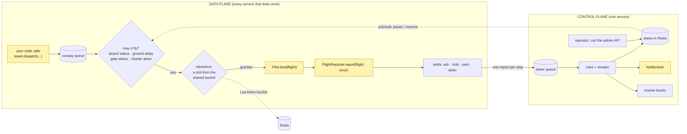

# The life of a flight

*Your code does two things: the work and the verdict. Everything between them is Traction's.*

A flight crosses two planes. The **data plane** runs in every service that does work: it pulls
a flight, checks it may fly, calls your pilot, asks your reporter what happened, and settles the
message. The **control plane** runs in one service: it reads every report, keeps the streaks,
and flips the statuses the data plane obeys. Yellow boxes are your code.

`NotifyHook` is yellow because it's yours to add; a log-line hook ships by default.

## Step by step

*The consumer checks the cheap things first, so a stopped scope never burns a vendor call.*

1. **Dispatch.** `Tower.dispatch` checks the airport and gate exist (an unknown one throws
   `IllegalArgumentException`, nothing queued), mints a `flightId`, stamps the payload's class,
   and publishes to the airport's runway.
2. **Airport status.** Stopped? The flight goes back to the runway tail and this consumer
   pauses itself. It resumes when the control plane broadcasts a reopen.
3. **Ground delay.** If the vendor recently throttled you, the consumer sleeps it out.
4. **Gate status.** A stopped gate parks its flights (`SKIPPED GATE_GROUNDED`, disposition
   `PARKED`) while other gates keep landing.
5. **Charter abort.** A flight of an aborted charter settles `SKIPPED CHARTER_ABORTED`, burning
   no slot.
6. **Payload.** JSON that won't convert to the stamped class is a `FLIGHT_FAULT`.
7. **Clearance.** One slot (or the gate's `slotCost`) from the airport's token bucket in Redis.
   Short waits sleep; long waits become a ground delay. If Redis can't answer, the flight is
   deferred, never flown unpaced.
8. **Land, then report.** Your pilot runs; your reporter classifies the result. A reporter that
   throws or returns null counts as `INTERNAL`.
9. **Settle**, per the table below, and send the row to the tower.

## Settle paths

*Each category maps to exactly one way the message leaves the consumer.*

| Reported | The message | Row written |
|---|---|---|
| `landed()` / `skipped(reason)` | acked | `RECORD`, `TERMINAL` |
| `FLIGHT_FAULT` | acked: rejected, no retry | `RECORD`, `TERMINAL` |
| `GATE_FAULT` | parked | `RECORD`, `PARKED` |
| `TRANSIENT` | holding queue with backoff (30 s, 2 min, 10 min), then parked | `INTERIM HELD_n`, then `RECORD PARKED` |
| `INTERNAL` | one 30 s hold, then parked | `INTERIM HELD_1`, then `RECORD PARKED` |
| `AIRPORT_FAULT` | back to the runway tail; consumer pauses | `INTERIM DEFERRED` |
| `RATE_LIMIT` | back to the runway tail; airport ground-delayed one slots window | `INTERIM DEFERRED` |

A path that moves the message (hold, park, defer) acks only after the broker confirms the
republish. If the consumer crashes mid-flight, the broker redelivers; after 20 redeliveries the runway dead-letters the flight to
parked. A held flight returns to the runway when its hold expires.

## What the control plane does with a report

*Rules turn reports into at most one status change, and one notification per change.*

- **`AIRPORT_FAULT`:** the first report ground-stops the airport.
- **`GATE_FAULT`:** 3 distinct `domainRef`s in 5 minutes ground-stop the gate.
- **`FLIGHT_FAULT` + `INTERNAL`:** 5 distinct in 5 minutes ground-stop the gate.
- **A landing** clears its gate's streaks.

Status changes are compare-and-set in Redis, so racing reports notify once. A reopen is always
a human's call (no auto-reopen); reports sent before the reopen can't re-ground the scope. The
control plane re-broadcasts each airport's stored status (and every stopped gate) once a
minute, so a consumer that missed a message catches up. Charter rows are counted here too: see [guarantees](guarantees.md).
